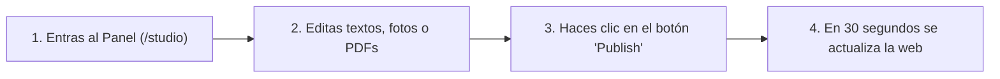

# Manual de Administración de Contenidos — Portal Web Jhonal 80

¡Bienvenido al manual de uso de tu sitio web **Jhonal 80**!
Este documento ha sido diseñado especialmente para la persona encargada de administrar y actualizar la información comercial del portal (textos, número de WhatsApp, fotos de fábrica, marcas, catálogo de prendas y archivos PDF), **sin necesidad de conocimientos técnicos ni de programación**.

---

## 1. ¿Cómo funciona tu sitio web?

Tu página web cuenta con un **Panel de Administración privado** llamado **Sanity Studio**. Todo cambio que guardes y publiques dentro de este panel se enviará automáticamente a la página web pública en cuestión de segundos.

---

## 2. Cómo ingresar al Panel de Administración

1. Abre tu navegador de internet (Google Chrome, Edge o Safari) desde tu computador o celular.
2. Escribe la dirección de tu página web seguida de **`/studio`** al final.
   * *Ejemplo:* `https://www.tudominio.com/studio`
3. Verás la pantalla de bienvenida de **Jhonal 80 - Panel de Administración**.
4. Inicia sesión con el correo electrónico autorizado (puedes ingresar con un clic usando **Google** o con tu correo y contraseña).

---

## 3. Conociendo la pantalla principal del Panel

Al ingresar a **Structure** (en la barra superior), verás la pantalla dividida en **3 columnas** de izquierda a derecha:

1. **Columna Izquierda (Menú Principal):** Muestra las **4 secciones** de tu página web:
   * **Marcas**
   * **Prendas y Referencias**
   * **Catálogos PDF**
   * **Personalización de Contenidos y Textos**
2. **Columna Central (Lista de elementos):** Al hacer clic en una sección del menú izquierdo, aquí verás la lista de marcas, prendas o catálogos creados, junto con el botón **`+`** (Crear nuevo) arriba a la derecha de esa columna.
3. **Columna Derecha (Formulario de edición):** Es donde escribes los textos, subes las fotos o archivos PDF y presionas el botón **Publish** (Publicar) abajo a la derecha.

> [!IMPORTANT]
> **La regla de oro — El botón "Publish" (Publicar):**
> Mientras escribes o subes fotos, el panel guarda tus cambios como un borrador automático (*Draft*), pero **tus clientes aún no los ven**. Para que los cambios salgan al aire en la página web, **siempre debes hacer clic en el botón verde/azul `Publish`** ubicado en la esquina inferior derecha. Una vez publicado, espera **30 segundos** y recarga tu página web para ver el cambio.

---

## 4. Orden recomendado para tu primera configuración

Si vas a cargar información desde cero por primera vez, sigue este orden lógico:

1. **Primero:** Configura tu número de WhatsApp y textos generales en **Personalización de Contenidos y Textos**.
2. **Segundo:** Registra tus 4 líneas (**Romper**, **Jhonal**, **Fénix** y **Lady's**) en la sección **Marcas**. *(Esto es necesario porque al crear prendas o catálogos el sistema te pedirá elegir a cuál de estas marcas pertenecen).*
3. **Tercero:** Sube tus productos en **Prendas y Referencias**.
4. **Cuarto:** Sube tus documentos descargables en **Catálogos PDF**.

---

## 5. Sección 1: Personalización de Contenidos y Textos

Esta sección controla todos los títulos, párrafos, números de teléfono, enlaces de redes sociales y fotos/videos de la fábrica.

### ¿Cómo abrirla?
1. En el menú izquierdo, haz clic en **Personalización de Contenidos y Textos**.
2. Si ya existe un documento en la columna central, selecciónalo. Si la lista está vacía, haz clic en el ícono **`+`** (arriba de la columna central) para crearlo por única vez.

> [!CAUTION]
> **Crea un solo documento de Personalización:** Solo necesitas tener **un (1)** documento dentro de *Personalización de Contenidos y Textos*. Siempre edita ese mismo documento cuando quieras cambiar teléfonos, títulos o fotos de la fábrica.

En la parte superior del formulario verás **8 pestañas numeradas** para encontrar cada parte de la página fácilmente:

---

### Pestaña `1. Contacto y Redes`
Aquí configuras a dónde llegarán los mensajes de tus clientes mayoristas:

* **Nombre de Empresa:** Nombre oficial (por defecto: `JHONAL 80`).
* **Número de WhatsApp (con código de país sin +):** **¡Este es el campo más importante del sitio!**
  * Escribe únicamente números, empezando por el código de Colombia (`57`) seguido de los 10 dígitos del celular, **sin espacios, sin guiones y sin el signo `+`**.
  * *Ejemplo correcto:* `573127818899`
  * *Ejemplo incorrecto:* `+57 312 781-8899`
  * Este número actualiza automáticamente el botón *Contáctanos* del menú superior, los botones de cotizar cada prenda, el formulario cotizador mayorista y el botón verde flotante de WhatsApp.
* **Teléfono Fijo o Celular de Contacto / Correo Electrónico / Dirección:** Datos informativos de respaldo de la empresa.
* **URL Instagram:** Enlace completo a tu perfil de Instagram (ej. `https://www.instagram.com/jhonal.80/`).
* **URL Facebook:** Enlace completo a tu página de Facebook.

---

### Pestaña `2. Portada / Hero`
Controla lo primero que ve un visitante al entrar a la web:

* **Distintivo Superior (Badge):** Frase corta que aparece arriba del título principal (ej. *Confección y diseño 100% colombiano • Desde 2007*).
* **Título Principal del Hero:** El titular grande de bienvenida (ej. *Fabricamos moda que impulsa tus ventas*).
* **Subtítulo / Descripción del Hero:** Texto de apoyo debajo del título principal.
* **Texto Botón Principal / Texto Botón Secundario:** Los textos dentro de los dos botones principales de la portada.
* **Tarjetas 1, 2, 3 y 4 (Título y Subtítulo):** Son los 4 recuadros informativos que aparecen al pie de la portada (*Precios de Fábrica*, *Envíos a toda Colombia*, *4 Marcas en 1 Pedido*, *Garantía Total*).

---

### Pestaña `3. Sección Marcas`
Controla el encabezado de la zona donde se presentan las 4 marcas:
* **Distintivo de Marcas (Badge):** Texto pequeño superior (ej. *Nuestras 4 marcas*).
* **Título de la Sección de Marcas:** Ej. *Ropa pensada para rotar y vender todos los días*.
* **Descripción de la Sección de Marcas:** Párrafo explicativo debajo del título.

---

### Pestaña `4. Fábrica y Talleres`
Controla la sección **Nuestra fábrica y talleres**, incluyendo sus textos, cifras, fotografías y el video real de producción:

* **Distintivo de Fábrica y Título de Fábrica:** Encabezado de la sección.
* **Párrafo 1 (Historia/Propósito) y Párrafo 2 (Proceso/Taller):** Textos donde cuentas la trayectoria de Jhonal 80, tus talleres de serigrafía, mesas de corte y confección directa.
* **Métricas 1, 2 y 3 (Número/Valor, Título y Descripción):** Son los 3 cuadros de estadísticas:
  * *Métrica 1:* `+17 años` / `Experiencia`
  * *Métrica 2:* `100%` / `Hecho en Colombia`
  * *Métrica 3:* `Directo` / `De fábrica`
* **Foto 1 de Planta (Mesa de corte / Estampado):**
  * Haz clic en **Upload** para subir una foto desde tu computador o arrástrala al recuadro.
  * Abajo puedes cambiar su **Título** (ej. *Talleres de serigrafía y estampado*) y **Subtítulo**.
* **Foto 2 de Planta (Confección / Empaque):**
  * Sube la segunda foto de tus instalaciones y personaliza su **Título** y **Subtítulo**.
* **Archivo de Video de Fábrica (MP4):**
  * Haz clic en **Upload** y selecciona un video en formato **`.mp4`** grabado en tu planta. Se mostrará en el reproductor de video de la página.

---

### Pestaña `5. Distribuidores`
Controla los textos de la sección **Conviértete en distribuidor de Jhonal.80**:
* **Distintivo Distribuidores (Badge):** Ej. *Gana con nosotros*.
* **Título Sección Distribuidores** y **Descripción Distribuidores**.
* **Texto Frase Destacada (Quote Banner):** La frase entre comillas que invita a formar alianzas comerciales a largo plazo.

---

### Pestañas `6. Portafolio / Prendas`, `7. Descarga de Catálogos` y `8. Cotizador B2B`
En cada una de estas tres pestañas puedes cambiar el **Distintivo (Badge)**, el **Título** y la **Descripción** que encabezan:
* El catálogo interactivo de prendas (*Portafolio*).
* La zona de descarga de catálogos en PDF.
* El formulario cotizador mayorista del final de la página.

Recuerda hacer clic en **`Publish`** abajo a la derecha cuando termines de editar cualquiera de estas pestañas.

---

## 6. Sección 2: Marcas

Aquí administras la información individual de cada una de tus líneas (**Romper**, **Jhonal**, **Fénix** y **Lady's**) o agregas una marca nueva en caso de lanzar otra línea en el futuro.

> [!TIP]
> **¿Cómo se conectan las marcas con la web?**
> Tu página web ya trae precargadas las 4 marcas (**Romper**, **Jhonal**, **Fénix** y **Lady's**). Cuando creas una marca en este panel con el mismo nombre (por ejemplo, `Romper`), la página combina y actualiza automáticamente los datos de esa tarjeta con el logo, descripción, referencias y colores que pongas aquí.

### Paso a paso para crear o editar una Marca

1. En el menú izquierdo, haz clic en **Marcas**.
2. Para crear una marca nueva, pulsa el botón **`+`** arriba de la columna central. Para modificar una existente, haz clic sobre su nombre en la lista.
3. Completa los campos del formulario:
   * **Nombre de la Marca (Obligatorio):** Escribe `Romper`, `Jhonal`, `Fénix` o `Lady's`.
   * **Slug (Obligatorio):** Haz clic en el botón **`Generate`** que está a la derecha del campo. El sistema llenará este código automáticamente a partir del nombre.
   * **Logo de la Marca:** Haz clic en **Upload** y sube el logo de la marca. **Recomendación:** Usa una imagen en formato **`.PNG` con fondo transparente** para que luzca impecable sobre el fondo oscuro de la página.
   * **Eslogan / Segmento:** Frase corta que aparece en la esquina superior de la tarjeta (ej. *Streetwear y deportivo* o *Lencería y ropa interior*).
   * **Color HEX de Acento:** Es el color que ilumina los bordes, botones y etiquetas de esa marca. Debe escribirse con el símbolo `#` seguido de 6 letras/números. Puedes usar estos códigos oficiales o cualquier otro:

| Marca | Color | Código para copiar y pegar |
| :--- | :--- | :--- |
| **Romper** | Naranja | `#EA580C` |
| **Jhonal** | Azul Rey | `#2563EB` |
| **Fénix** | Dorado / Ámbar | `#D97706` |
| **Lady's** | Rosa / Fucsia | `#DB2777` |

   * **Descripción de la línea:** Resumen de 2 o 3 renglones sobre qué tipo de prendas ofrece esta marca.
   * **Referencias más pedidas:** Ejemplo: `6016 / 6005` o `Invisible y encaje`.
   * **Tipo de tela / Tecnología textil:** Ejemplo: `Tela fría con spandex` o `Algodón licrado premium`.
   * **Orden de visualización:** Escribe un número (`1`, `2`, `3` o `4`) para decidir en qué posición de izquierda a derecha quieres que aparezca la marca.
4. Haz clic en el botón **`Publish`** abajo a la derecha.

---

## 7. Sección 3: Prendas y Referencias (Catálogo Interactivo / Lookbook)

Aquí subes las prendas que tus clientes pueden filtrar por marca y cotizar con un clic por WhatsApp.

> [!WARNING]
> **Importante al subir tu primera prenda:**
> Mientras esta sección esté vacía en el panel, la página web muestra **16 prendas de muestra** para que el catálogo se vea lleno. **En el momento en que publiques tu primera prenda aquí, las 16 prendas de muestra se ocultarán** y la página mostrará únicamente las prendas que tú hayas subido en este panel. Por eso, te recomendamos subir al menos varias prendas de cada marca cuando decidas actualizar el catálogo.

### Paso a paso para agregar una Prenda

1. En el menú izquierdo, haz clic en **Prendas y Referencias**.
2. Haz clic en el botón **`+`** arriba de la columna central.
3. Llena la información de la prenda:
   * **Nombre de la Prenda (Obligatorio):** Ej. *Camiseta polo Romper azul petróleo*.
   * **Código de Referencia (REF) (Obligatorio):** Escribe el código tal como quieres que llegue al mensaje de WhatsApp (ej. `REF: 6002-02` o `REF: LDY-BRA-01`).
   * **Marca (Obligatorio):** Haz clic en el selector y elige a cuál de tus marcas pertenece (`Romper`, `Jhonal`, `Fénix` o `Lady's`). *Nota: Para que el botón de filtro del catálogo web la encuentre correctamente, asegúrate de que la marca se llame exactamente Romper, Jhonal, Fénix o Lady's.*
   * **Subtítulo / Colección:** Frase breve que acompaña al título (ej. *Confección premium con detalles en cuello*).
   * **Categoría:** Aparece arriba del nombre de la prenda (ej. *Polo hombre deportiva y casual* o *Lencería & Ropa interior femenina*).
   * **Composición de Tela:** Aparece en la ficha técnica (ej. *96% Algodón Frío, 4% Spandex*).
   * **Silueta / Ajuste:** Aparece debajo de la tela (ej. *Regular fit* o *Tallas S, M, L, XL*).

### Cómo agregar los circulitos de colores de la prenda (`Paleta de Colores Disponibles`)
Cada tarjeta de prenda puede mostrar pequeños círculos con los colores en los que fabricas esa referencia:
1. En el campo **Paleta de Colores Disponibles (Códigos HEX)**, haz clic en el botón **`Add item`**.
2. Escribe el código de color con `#` (por ejemplo, `#FFFFFF` para blanco) y presiona Enter o vuelve a hacer clic en **`Add item`** para agregar otro color.
3. Aquí tienes una tabla rápida de colores textiles comunes listos para copiar y pegar:

| Color de la prenda | Código HEX | Color de la prenda | Código HEX |
| :--- | :--- | :--- | :--- |
| **Blanco** | `#FFFFFF` | **Azul Rey** | `#2563EB` |
| **Negro** | `#18181B` | **Azul Oscuro / Naval** | `#1E293B` |
| **Gris Claro / Perla** | `#9CA3AF` | **Azul Petróleo** | `#0284C7` |
| **Gris Oscuro / Ratón** | `#4B5563` | **Verde Esmeralda** | `#059669` |
| **Rojo** | `#DC2626` | **Café / Tierra** | `#78350F` |
| **Vino Tinto / Burdeos** | `#881337` | **Palo de Rosa** | `#FCE7F3` |
| **Fucsia / Rosa Intenso** | `#E11D48` | **Beige / Piel / Almendra** | `#E4D5C7` |

*(Si buscas un tono específico, puedes escribir en Google "selector de color hex", elegir el tono en pantalla y copiar el código que empieza con `#`).*

### Cómo subir y encuadrar la Foto Principal
1. En **Foto Principal**, haz clic en **Upload** y selecciona la foto de la prenda (en formato `.jpg`, `.jpeg` o `.png`).
2. **Truco para que nunca se corte la cabeza o el cuello de la prenda:**
   * Una vez subida la foto, haz clic en el ícono de **recorte / editar** (el lápiz o el ícono de encuadre arriba a la derecha de la foto).
   * Verás un círculo sobre la imagen llamado **Hotspot**. Arrastra ese círculo hacia el pecho o cuello de la prenda. Así el sitio web sabrá qué parte de la foto debe mantener siempre centrada en celulares y computadores.
3. Finalmente, haz clic en **`Publish`** abajo a la derecha.

---

## 8. Sección 4: Catálogos PDF

Aquí administras los archivos PDF que los distribuidores pueden descargar en la sección **Catálogos de la colección**.

> [!NOTE]
> Al igual que con las prendas, mientras no hayas publicado ningún catálogo en esta sección, la web mostrará los catálogos iniciales precargados. En cuanto publiques el primer catálogo aquí, la página mostrará los catálogos que subas desde este panel.

### Paso a paso para subir un Catálogo PDF

1. En el menú izquierdo, haz clic en **Catálogos PDF**.
2. Pulsa el botón **`+`** arriba de la columna central.
3. Completa los campos:
   * **Título del Catálogo (Obligatorio):** Ej. *Catálogo Romper Conjuntos* o *Catálogo Fénix Oversize*.
   * **Marca:** Selecciona la marca correspondiente.
   * **Año / Temporada:** Por defecto aparece `2026`. Puedes cambiarlo por `2026 - Semestre II`, `Colección Fin de Año`, etc.
   * **Descripción breve:** Texto corto que explica qué incluye ese PDF (ej. *Conjuntos para hombre, camisetas en tela fría y polos deportivos*).
   * **Archivo PDF (Obligatorio):** Haz clic en **Upload** y selecciona el archivo `.pdf` desde tu computador. Espera unos segundos hasta que la barra de carga llegue al 100%.
   * **Color de borde:** Escribe el código de color HEX para la línea decorativa superior de la tarjeta (ej. `#EA580C` para Romper, `#2563EB` para Jhonal, `#D97706` para Fénix o `#DB2777` para Lady's).
4. Haz clic en **`Publish`** abajo a la derecha.

---

## 9. Cómo editar, despublicar o eliminar un elemento

En cualquiera de las secciones (**Marcas**, **Prendas y Referencias** o **Catálogos PDF**), tienes control total sobre los elementos existentes:

* **Para modificar algo:** Haz clic sobre el elemento en la lista central, cambia el texto o la foto, y vuelve a presionar **`Publish`**.
* **Para ocultar temporalmente una prenda o catálogo sin borrarlo (Unpublish):**
  1. Abre la prenda o catálogo.
  2. Haz clic en el botón de los **tres puntos (`•••`)** que está justo al lado del botón `Publish` (abajo a la derecha).
  3. Elige la opción **`Unpublish`**. La prenda dejará de verse en la página web, pero quedará guardada en tu panel por si vuelve a haber stock más adelante.
* **Para borrar definitivamente una prenda o catálogo (Delete):**
  1. Abre el elemento que deseas eliminar.
  2. Haz clic en los **tres puntos (`•••`)** junto al botón `Publish`.
  3. Selecciona **`Delete`** y confirma.

---

## 10. Preguntas Frecuentes del Administrador

### 1. ¿Por qué hice un cambio y todavía no lo veo en la página web?
Verifica dos cosas:
1. Que el botón inferior derecho haya sido presionado (cuando los cambios ya están publicados, el botón **`Publish`** aparece desactivado y dice *Published*).
2. Espera **30 segundos** después de publicar y actualiza la página web en tu navegador (`F5` o el botón de recargar).

### 2. ¿Qué tamaño o peso deben tener las fotos y los PDF?
* **Fotos de prendas y fábrica:** Puedes subir fotos tomadas con celular o cámara profesional en formato `.jpg` o `.png`. El sistema de Sanity las optimiza y recorta automáticamente para que la página cargue rápido.
* **Logos de marcas:** Preferiblemente en formato `.png` con fondo transparente.
* **Archivos PDF:** Se recomienda que cada archivo PDF pese menos de **20 MB** para que tus clientes mayoristas puedan descargarlo rápidamente desde sus datos móviles.

### 3. Creé una prenda nueva, pero al usar los botones de filtro del catálogo no aparece en su marca. ¿Por qué?
Los botones de filtro de la página web buscan los nombres **Romper**, **Jhonal**, **Fénix** y **Lady's**. Revisa que la prenda tenga asignada su marca en el campo **Marca**, y que el nombre de esa marca en la sección **Marcas** esté escrito correctamente.

### 4. ¿Cómo funcionan los mensajes que llegan al WhatsApp?
* Cuando un cliente hace clic en **"Cotizar por WhatsApp"** debajo de una prenda, a tu WhatsApp llegará automáticamente el nombre de la prenda, su código `REF` y la marca que tú escribiste en el panel.
* Cuando un cliente llena el **Cotizador para mayoristas** al final de la página, a tu WhatsApp llegará una ficha ordenada con el nombre del cliente/negocio, su ciudad, la marca de interés, la cantidad de prendas que desea comprar y sus comentarios.
